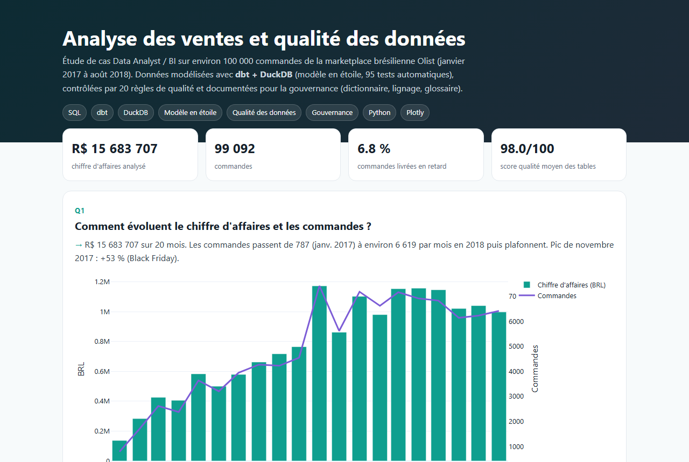

# Olist: sales analytics and data governance

**Data Analyst / BI case study** on about 100,000 orders from a Brazilian e-commerce marketplace:
**dbt + DuckDB** modelling, 10 business questions answered in **SQL**, **20 data quality rules** measured on every run,
and full **governance** documentation (roles, sensitivity, glossary, lineage).

[Version française](README.md) ·
[Interactive report](https://tsitohaina23.github.io/olist-analytics-governance/report/) ·
[Data dictionary and lineage](https://tsitohaina23.github.io/olist-analytics-governance/dbt-docs/) ·
[Governance policy (FR)](GOUVERNANCE.md)



## At a glance

| | |
| --- | --- |
| **Data** | 9 public Olist files (1.5 million rows), orders from 2016 to 2018 |
| **Stack** | SQL · dbt 1.9 · DuckDB · Python (pandas, Plotly) · RDF/SKOS · GitHub Actions |
| **Modelling** | 22 layered dbt models (staging → intermediate → marts), star schema, data contract |
| **Quality** | 95 dbt tests + 31 Python tests, 20 quality rules scored per table |
| **Governance** | Owner, data steward and sensitivity level on every table; business glossary; lineage |

## Business questions

Monthly revenue trend · average order value by region · top categories · cohort retention · delivery delays by
state · impact of late delivery on review scores · repeat customers · seller concentration (Pareto) · ordering
patterns by day and hour · payment methods and installments.
Commented queries are in [`sql/analyses/`](sql/analyses) (CTEs, window functions, `qualify`).
All results are in [`reports/RESULTATS.md`](reports/RESULTATS.md).

## Key findings (January 2017 – August 2018)

- **R$15.7M** in revenue. Monthly orders grew from 787 to about 6,600, then plateaued in 2018. Black Friday
  (2017-11-24) reached **1,176 orders**, 4.7× the monthly daily average.
- **Late delivery destroys satisfaction:** on-time orders average **4.29/5**. After one week of delay, the average drops to **1.74/5**,
  with **78% negative reviews**. 6.7% of delivered orders are late.
- **The North-East is underserved:** Alagoas averages 24.5 delivery days and a 21.5% late rate, versus 8.7 days and 4.5% in São Paulo.
- **Very low loyalty:** only **3% of customers** buy again (5.6% of revenue), but they are worth **1.9× more**.
  Only 1.4–2.3% of a cohort returns within 6 months.
- **High concentration:** the **top 10% of sellers make 67%** of revenue, and the top 10 categories make 62% (out of 74). Credit cards cover
  75% of orders; paying in 7 to 10 installments goes with a R$334 basket, versus R$101 for single payments.

## Data quality and governance

- **Nothing is hidden:** staging drops no rows. Every anomaly is **measured** (`quality` layer) and handled by an
  **explicit business rule**, documented in [GOUVERNANCE.md](GOUVERNANCE.md).
- **Quality score per table:** geolocation scores 86.0 (28% exact duplicate rows); every other table scores 99.4 or more.
  Details and recommended fixes at the source are in [`reports/QUALITE.md`](reports/QUALITE.md).
- **Data contract** on `fct_orders`. **Metadata** on every model: owner, steward, and `public` / `internal` / `pii` sensitivity.
  Free-text reviews never leave the pipeline.
- **Business glossary in RDF/SKOS** ([`governance/glossaire.ttl`](governance/glossaire.ttl)): 19 bilingual concepts,
  each linked to the dbt column that computes it. It can be opened in Protégé or queried with SPARQL.
- **Lineage and dictionary** generated by dbt, with 2 exposures to assess the impact of a change. A test enforces
  that analyses only read the certified `marts` layer.

## Reproduce (3 commands)

```bash
python -m venv .venv && source .venv/bin/activate     # Windows: .venv\Scripts\activate
pip install -r requirements.txt
python scripts/pipeline.py
```

The script downloads the data (checking each file's row count), runs `dbt build`, then runs the analyses and builds the
reports and documentation. Then run `pytest -q`. See [`docs/DASHBOARD.md`](docs/DASHBOARD.md) for Looker Studio and Power BI.

## Limitations

Public anonymised data from 2016–2018 · revenue is GMV (no costs, returns or fees) · the delay → score link is a strong
correlation, not proven causality · retention is measured up to August 2018 · 269 customers have a ZIP prefix missing from
the geolocation reference.

## Data and license

Data: [Brazilian E-Commerce Public Dataset by Olist](https://www.kaggle.com/datasets/olistbr/brazilian-ecommerce),
**CC BY-NC-SA 4.0**. The data is not stored in the repository: it is downloaded from a public Hugging Face copy and checked against the official row counts.
Code: MIT ([LICENSE](LICENSE)). Derived data files follow CC BY-NC-SA 4.0.

---
Sitraka Tsitohaina RAJOELISOLO · Data Analyst / BI · [Portfolio](https://portfolio-tsitohaina.vercel.app) · [GitHub](https://github.com/tsitohaina23)
