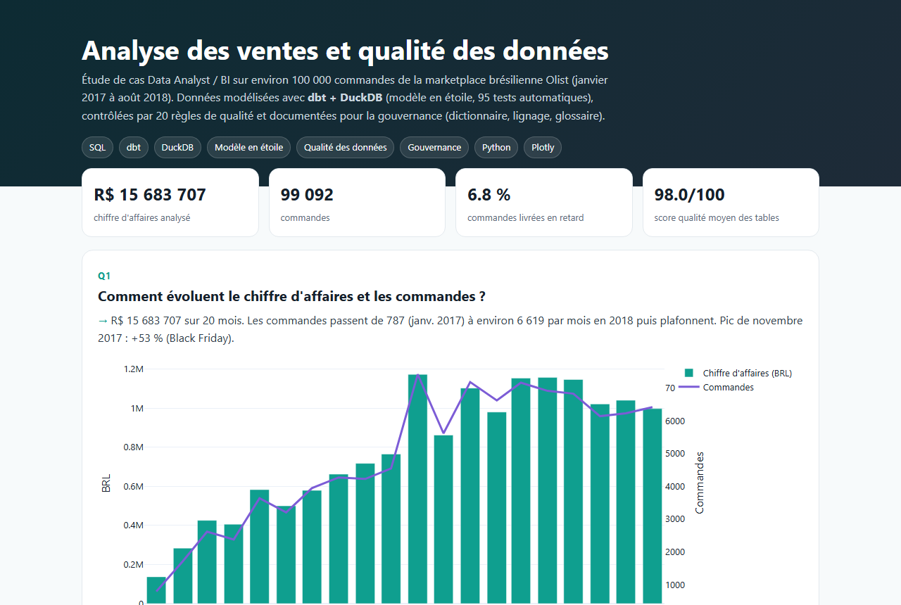

# Olist : analyse des ventes et gouvernance des données

**Étude de cas Data Analyst / BI** sur environ 100 000 commandes d'une marketplace e-commerce brésilienne :
modélisation **dbt + DuckDB**, 10 questions métier en **SQL**, **20 règles de qualité** mesurées à chaque exécution
et une documentation de **gouvernance** complète (rôles, sensibilité, glossaire, lignage).

[English version](README.en.md) ·
[Rapport interactif](https://tsitohaina23.github.io/olist-analytics-governance/report/) ·
[Dictionnaire et lignage](https://tsitohaina23.github.io/olist-analytics-governance/dbt-docs/) ·
[Politique de gouvernance](GOUVERNANCE.md)



<!-- Vidéo de démonstration : glisser-déposer docs/media/demo.mp4 ici dans l'éditeur GitHub -->

## En bref

| | |
| --- | --- |
| **Données** | 9 fichiers publics Olist (1,5 million de lignes), commandes de 2016 à 2018 |
| **Stack** | SQL · dbt 1.9 · DuckDB · Python (pandas, Plotly) · RDF/SKOS · GitHub Actions |
| **Modélisation** | 22 modèles dbt en couches (staging → intermediate → marts), modèle en étoile, contrat de données |
| **Qualité** | 95 tests dbt + 31 tests Python, 20 règles de qualité notées par table |
| **Gouvernance** | Propriétaire, data steward et niveau de sensibilité sur chaque table ; glossaire métier ; lignage |

## Contexte et questions

Une marketplace veut comprendre ses ventes, sa logistique et la fidélité de ses clients, **en s'appuyant sur des
données dont la qualité est mesurée**. Les 10 questions traitées :

1. Comment évoluent le chiffre d'affaires et les commandes chaque mois ?
2. Le panier moyen et le poids du port varient-ils selon la région ?
3. Quelles catégories pèsent le plus ?
4. Les clients reviennent-ils acheter (rétention par cohorte) ?
5. Où les livraisons sont-elles lentes et en retard ?
6. Quel est l'impact d'un retard sur la note client ?
7. Quelle part des clients rachète, et que pèsent-ils ?
8. Le chiffre d'affaires est-il concentré sur quelques vendeurs ?
9. À quels jours et à quelles heures les clients commandent-ils ?
10. Le moyen de paiement change-t-il le panier ?

Chaque requête commentée se trouve dans [`sql/analyses/`](sql/analyses) (CTE, fonctions de fenêtrage, `qualify`),
et tous les résultats dans [`reports/RESULTATS.md`](reports/RESULTATS.md).

## Principaux résultats (janvier 2017 – août 2018)

- **R$ 15,7 millions** de chiffre d'affaires. Les commandes passent de 787 par mois à environ 6 600, puis plafonnent en 2018.
  Le Black Friday (24/11/2017) atteint **1 176 commandes**, soit 4,7 fois la moyenne du mois.
- **Le retard détruit la satisfaction :** une commande à l'heure obtient **4,29/5**. Au-delà d'une semaine de
  retard, la note tombe à **1,74/5**, avec **78 % d'avis négatifs**. 6,7 % des commandes livrées sont en retard.
- **Le Nordeste est mal desservi :** l'Alagoas cumule 24,5 jours de délai moyen et 21,5 % de retards, contre 8,7 jours et
  4,5 % à São Paulo.
- **Très faible fidélité :** seuls **3 % des clients** rachètent (5,6 % du chiffre d'affaires), mais ils valent
  **1,9 fois plus**. Seuls 1,4 à 2,3 % d'une cohorte reviennent dans les 6 mois.
- **Forte concentration :** les **10 % meilleurs vendeurs font 67 %** du chiffre d'affaires, et les 10 premières
  catégories 62 % (sur 74). La carte de crédit couvre 75 % des commandes ; payer en 7 à 10 fois accompagne un panier
  de R$ 334, contre R$ 101 au comptant.

## Recommandations

| Constat | Recommandation | Indicateur de suivi |
| --- | --- | --- |
| Le retard fait chuter la note | Annoncer des dates réalistes au Nordeste et au Norte ; prévenir le client dès qu'un retard est probable | Taux de retard, note moyenne |
| Retards concentrés au Nordeste | Évaluer un entrepôt ou un transporteur régional ; afficher le délai par État avant l'achat | Délai médian par État |
| Fidélité quasi nulle | Relance dans les 30 jours après la livraison, programme de fidélité sur les catégories à rachat | Rétention M+1 à M+6 |
| Dépendance aux gros vendeurs | Suivi dédié du premier décile ; accompagnement des petits vendeurs | Part du chiffre d'affaires du décile 1 |
| Les mensualités font grimper le panier | Mettre en avant le paiement en plusieurs fois sur les catégories chères | Panier moyen par moyen de paiement |

## Qualité et gouvernance

**Score de qualité par table** (règles mesurées à chaque exécution, détail dans [`reports/QUALITE.md`](reports/QUALITE.md)) :

| Table | Score /100 | Principal problème |
| --- | --- | --- |
| geolocation | 86,0 | 28 % de lignes en double exact (1 000 163 points pour environ 19 000 codes postaux) |
| products | 99,4 | 610 produits sans catégorie ; 2 catégories sans traduction |
| reviews | 99,5 | 789 avis partagés entre plusieurs commandes ; 547 commandes avec plusieurs avis |
| customers · sellers · orders | 99,7 à 99,8 | Codes postaux absents du référentiel ; 775 commandes sans article |
| payments · order_items | 100 | Seulement quelques paiements « not_defined » ou à 0 |

**Principe :** aucune anomalie n'est masquée. La couche staging ne supprime aucune ligne. Chaque anomalie est
**mesurée** (couche `quality`) puis **traitée par une règle de gestion explicite**, documentée dans [GOUVERNANCE.md](GOUVERNANCE.md).

- **Contrat de données** sur `fct_orders` : les noms et types de colonnes sont garantis pour les tableaux de bord.
- **Métadonnées** sur chaque modèle : propriétaire, data steward et sensibilité (`public`, `internal`, `pii`).
  Les textes libres des avis ne sortent jamais du pipeline.
- **Glossaire métier** en RDF/SKOS ([`governance/glossaire.ttl`](governance/glossaire.ttl)) : 19 concepts définis en
  français et en anglais, chacun relié à la colonne dbt qui le calcule. Il s'ouvre dans Protégé et s'interroge en SPARQL.
- **Lignage et dictionnaire** générés par dbt, avec 2 expositions (rapport et étude SQL) pour mesurer l'impact d'un changement.
- **Règle d'usage testée :** les analyses ne lisent que la couche certifiée `marts`.

## Architecture

```mermaid
flowchart LR
  subgraph Sources["Sources Olist (9 CSV)"]
    R1[orders] & R2[order_items] & R3[payments] & R4[reviews] & R5[customers] & R6[sellers] & R7[products] & R8[geolocation]
  end
  REF[(Référentiels<br/>seeds)]
  subgraph Staging["staging : typage, aucune ligne supprimée"]
    S[stg_olist__*]
  end
  subgraph Intermediate["intermediate"]
    I1[int_orders__items] & I2[int_orders__payments] & I3[int_orders__reviews] & I4[int_geolocation__zip_centroids]
  end
  subgraph Marts["marts certifiés (étoile)"]
    F1[[fct_orders<br/>contrat]] & F2[[fct_order_items]]
    D1[dim_customers] & D2[dim_products] & D3[dim_sellers] & D4[dim_geography] & D5[dim_dates]
  end
  Q[quality<br/>dq_checks · dq_table_scores]
  Sources --> S --> Intermediate --> Marts
  REF --> S & Marts
  S --> Q
  Marts --> A[10 analyses SQL] & B[Rapport interactif] & E[Exports BI]
```



```
├── dbt/                  projet dbt : modèles, tests, référentiels, macros
│   └── models/{staging,intermediate,marts,quality}
├── sql/analyses/         10 questions métier (+ 2 compléments)
├── scripts/              téléchargement, pipeline, analyses, rapports
├── governance/           glossaire métier RDF/SKOS
├── reports/              RESULTATS.md, QUALITE.md, résultats CSV
├── exports/              jeux agrégés pour Looker Studio / Power BI
├── docs/                 rapport interactif, documentation dbt, guide tableau de bord, médias
└── tests/                tests Python (gouvernance et cohérence)
```

## Reproduire (3 commandes)

Prérequis : Python 3.10 ou plus récent. Le pipeline prend environ 1 minute, téléchargement compris.

```bash
python -m venv .venv && source .venv/bin/activate     # Windows : .venv\Scripts\activate
pip install -r requirements.txt
python scripts/pipeline.py
```

Le script télécharge les données (avec contrôle du nombre de lignes de chaque fichier), lance `dbt build`, puis exécute
les analyses et génère les rapports et la documentation. Lancer ensuite `pytest -q` pour les tests Python.
Pour un tableau de bord Looker Studio ou Power BI, voir [`docs/DASHBOARD.md`](docs/DASHBOARD.md).

## Limites

- Données publiques anonymisées de 2016 à 2018 : les tendances ne décrivent pas le marché actuel.
- Le chiffre d'affaires est un **GMV** (articles + port) : ni coûts, ni retours, ni commissions.
- Le lien retard → note est une **corrélation forte**, pas une causalité démontrée.
- La rétention est mesurée jusqu'en août 2018 ; les cohortes récentes ont moins de recul.
- 269 clients ont un code postal absent du référentiel de géolocalisation : ils sont conservés, sans coordonnées GPS.

## Données et licence

- **Données :** [Brazilian E-Commerce Public Dataset by Olist](https://www.kaggle.com/datasets/olistbr/brazilian-ecommerce),
  licence **CC BY-NC-SA 4.0**. Elles ne sont pas incluses dans le dépôt : le script les récupère depuis une copie publique
  sur Hugging Face et vérifie que chaque fichier a exactement le nombre de lignes de la publication officielle.
- **Code :** licence MIT ([LICENSE](LICENSE)). Les fichiers dérivés des données suivent la licence CC BY-NC-SA 4.0.

---
Sitraka Tsitohaina RAJOELISOLO · Data Analyst / BI · [Portfolio](https://portfolio-tsitohaina.vercel.app) · [GitHub](https://github.com/tsitohaina23)
